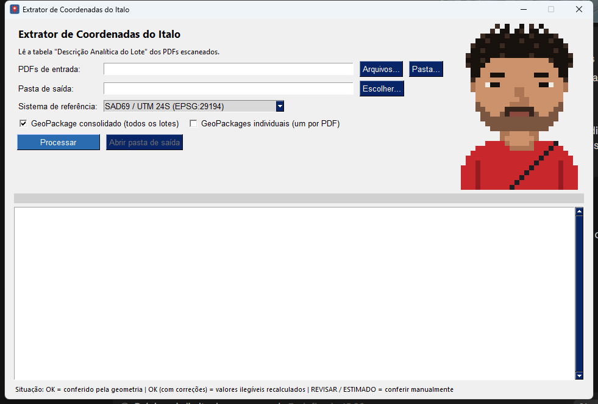

# Extrator de Coordenadas do Italo

Extrai a tabela de coordenadas ("Descrição Analítica do Lote") de processos fundiários
escaneados (Convênio INCRA / Estado de Sergipe, década de 1980) e gera CSV e GeoPackage.

Os PDFs não seguem um padrão: a página da tabela pode ser a 2ª, a 5ª ou a 24ª. O programa
encontra a página sozinho, lê a tabela por OCR e confere cada coordenada pela geometria do lote.



## Como funciona

```
PDF escaneado
  │ 1. triagem: OCR rápido (150 DPI, em paralelo) de todas as páginas
  │ 2. classificação: pontua páginas por palavras-chave + nº de coordenadas UTM
  │    → página da tabela e páginas do memorial descritivo
  │ 3. cabeçalho: município, distrito, gleba e lote (votação entre várias leituras;
  │    município corrigido pela lista dos 75 municípios de Sergipe)
  │ 4. tabela: detecção de linhas/colunas pela tinta da imagem, OCR por coluna em
  │    4 binarizações, escolha dos candidatos pela consistência geométrica
  │ 5. conferência: perímetro e área calculados × valores impressos
  ▼
CSV + GeoPackage + relatório
```

**Validação geométrica.** A tabela traz, para cada lado, distância, azimute e as coordenadas
E/N. Distância e azimute podem ser recalculados a partir das coordenadas, então cada coordenada
lida é confirmada pelos dois lados vizinhos. Valores ilegíveis no scan (ex.: onde passa a dobra
do papel) são recalculados e registrados na coluna `observacao`.

**Lotes sem tabela de coordenadas.** Alguns processos não têm a página "Descrição Analítica".
Nesse caso a poligonal é reconstruída pelos azimutes/distâncias da planta e do memorial, a
partir da lat/long do marco inicial. O resultado sai como `ESTIMADO` ou `REVISAR` e deve ser
conferido manualmente.

## Saídas

| Arquivo | Conteúdo |
|---|---|
| `MUNICIPIO_DISTRITO_GLEBA_LOTE_n.csv` | vértices: ponto A, ponto B, distância, azimute, E, N, status (`;` e vírgula decimal) |
| `lotes_consolidado.gpkg` | camadas `poligono` e `vertices` de todos os lotes processados |
| `MUNICIPIO_DISTRITO_GLEBA_LOTE_n.gpkg` | opcional: um GeoPackage por PDF |
| `relatorio.csv` | uma linha por PDF: situação, página usada, perímetro/área calculados e do documento, avisos |

Situação: `OK` (tudo conferido), `OK (com correções)` (valores recalculados), `ESTIMADO` /
`REVISAR` (conferir manualmente), `ERRO`.

Sistema de referência padrão: **SAD69 / UTM 24S (EPSG:29194)**, selecionável na interface
(SIRGAS 2000 e Córrego Alegre também disponíveis).

## Uso

**Executável (Windows):** baixe `ExtratorCoordenadas.exe` na página de *Releases*, dê dois
cliques, escolha os PDFs (ou uma pasta) e clique em **Processar**. Não precisa instalar nada.

**Pelo código-fonte:**

```bash
python -m venv .venv
.venv\Scripts\pip install -r requirements.txt
.venv\Scripts\python app.py                                  # interface gráfica
.venv\Scripts\python app.py --cli "C:\pasta\dos\pdfs" saida  # sem interface
```

## Gerar o executável

```bash
.venv\Scripts\pyinstaller ExtratorCoordenadas.spec --noconfirm
```

Gera `dist/ExtratorCoordenadas.exe` (~85 MB) com o Tesseract embutido. Se o Python usado no
venv vier do Anaconda, o `.spec` já inclui as DLLs de `Library\bin` (sqlite, tcl/tk etc.) que
o PyInstaller não encontra sozinho.

Para regenerar o ícone e o retrato em pixel art: `.venv\Scripts\python assets\gerar_assets.py`.

## Estrutura

```
app.py                     interface gráfica (FreeSimpleGUI) e modo --cli
extrator/
  ocr.py                   renderização (PyMuPDF), binarização e chamadas ao Tesseract
  cabecalho.py             classificação de páginas e leitura de município/distrito/gleba/lote
  tabela.py                leitura da tabela analítica + solver geométrico
  memorial.py              fallback: poligonal pela planta/memorial
  geo.py                   geometria, conversão geográfica → UTM, sistemas de referência
  saida.py                 CSV, relatório e GeoPackage (sqlite puro, sem GDAL)
  pipeline.py              esteira completa
tesseract/                 Tesseract 5.5 para Windows (só as DLLs necessárias + por/eng/osd)
assets/                    ícone, retrato e o script que os gera
ExtratorCoordenadas.spec   configuração do PyInstaller
```

## Limitações conhecidas

- Calibrado para o layout da Geodata S.A. (1985). Outros modelos de tabela podem precisar de ajuste.
- O distrito é lido por OCR sem dicionário: pode sair com erro de letra.
- No fallback por planta, o zero cortado (Ø) das plantas é lido como 8; o fechamento da poligonal
  detecta o problema, mas nem sempre o corrige.

## Licenças de terceiros

[Tesseract OCR](https://github.com/tesseract-ocr/tesseract) (Apache 2.0) ·
[PyMuPDF](https://github.com/pymupdf/PyMuPDF) (AGPL 3.0) ·
[FreeSimpleGUI](https://github.com/spyoungtech/FreeSimpleGUI) (LGPL 3.0)
